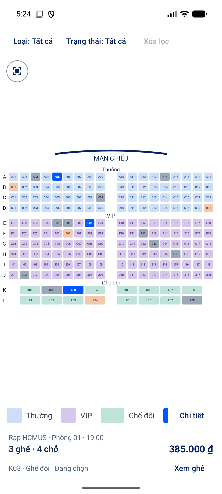
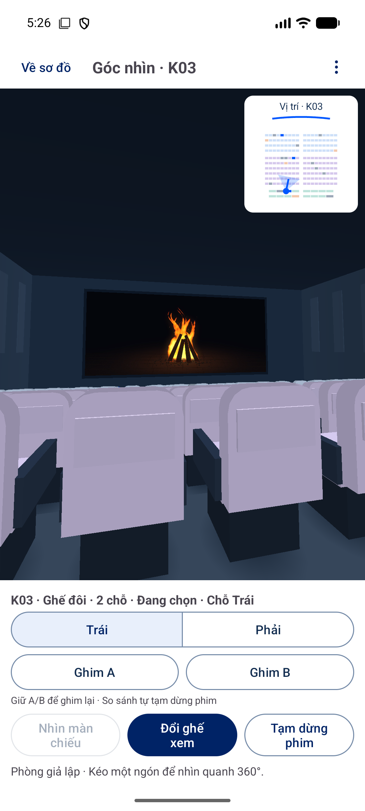
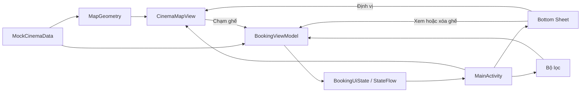

# CinemaMap — Sơ đồ phòng chiếu rạp phim

Bài giữa kỳ cá nhân học phần **Phát triển phần mềm cho thiết bị di động**, đề tài 2: sơ đồ phòng chiếu rạp phim. Ứng dụng được xây dựng bằng Kotlin và Android Views/XML. Toàn bộ sơ đồ ghế 2D được vẽ trên một `Custom View/Canvas`; dữ liệu sử dụng là dữ liệu giả lập cục bộ.

- [Mã nguồn GitHub](https://github.com/thanhbinh55/CinemaMap).
- [Video minh họa có lời đọc tiếng Việt — 4 phút 49 giây](https://drive.google.com/file/d/1piFknaiIjQugRZJtInKxAXeU10-ymsua/view?usp=drivesdk).
- [Thư mục video được chia sẻ](https://drive.google.com/drive/folders/1eWUSIrnI01RcwsKR_1XceOQVAFMKFwfS).

Video liên kết trực tiếp hiện là bản 1080p. Nội dung được ghi từ thao tác trên ứng dụng; con trỏ, chú thích và lời đọc được bổ sung trong quá trình biên tập.

## Giao diện ứng dụng

<table>
  <tr>
    <th>Sơ đồ phòng chiếu</th>
    <th>Góc nhìn 3D từ ghế</th>
  </tr>
  <tr>
    <td></td>
    <td></td>
  </tr>
</table>

Ảnh chụp trực tiếp từ bản Debug trên máy ảo Android API 37.

## Chức năng

| Nhóm | Nội dung thực hiện |
| --- | --- |
| Sơ đồ phòng chiếu | 196 đối tượng ghế, ba khu Thường/VIP/Ghế đôi, màn chiếu, lối đi giữa và nhãn hàng A–L |
| Trạng thái | Trống, đang chọn, đã đặt, không khả dụng; phân biệt bằng màu nền và thông tin chi tiết |
| Di chuyển và thu phóng | Kéo một ngón theo hai trục; pinch quanh tâm hai ngón; giới hạn pan và tỷ lệ zoom |
| Chạm ghế | Chọn/bỏ chọn ghế trống; xem thông tin ghế đã đặt hoặc không khả dụng; hit-testing theo tọa độ sau biến đổi |
| Công cụ hỗ trợ | Chú thích, lọc kết hợp loại và trạng thái, hiển thị điều kiện lọc, thông báo rỗng và xóa lọc |
| Reset View | Hoạt ảnh về vị trí và tỷ lệ mặc định; giữ lựa chọn, bộ lọc và trạng thái Bottom Sheet |
| Bottom Sheet | Hai nấc thu gọn/mở rộng; danh sách cuộn; định vị và xóa từng ghế; đồng bộ với Canvas |
| Xoay màn hình | Bố cục dọc/ngang riêng; giữ lựa chọn, bộ lọc, số chỗ, tạm tính và góc nhìn tương đối |
| Mở rộng 3D | Xem từ ghế, nhìn quanh, đổi ghế, chọn bên ghế đôi, so sánh A/B, bản đồ nhỏ, toàn màn hình và cấu hình phòng |

Ứng dụng mô phỏng một suất chiếu, không tích hợp API, cơ sở dữ liệu hay thanh toán. Chức năng 3D là phần mở rộng của đề tài. Phòng 3D sử dụng kích thước giả lập, chưa hiệu chuẩn với rạp thực tế.

## Hướng dẫn chạy

| Thành phần | Cấu hình dự án |
| --- | --- |
| Ngôn ngữ và giao diện | Kotlin; Android Views/XML; Material Components |
| Android | `minSdk 26`, `compileSdk 37`, `targetSdk 37` |
| Gradle Wrapper / Android Gradle Plugin | 9.6.0 / 9.4.1 |
| JDK chạy Gradle | JDK 25 trong môi trường kiểm chứng |
| Java source/target | 11 |

1. Clone repository và mở thư mục `CinemaMap` bằng Android Studio.
2. Cài Android SDK Platform 37, cấu hình SDK và chọn JDK cho Gradle.
3. Đồng bộ Gradle, chọn thiết bị Android API 26 trở lên và chạy module `app`.

```sh
git clone https://github.com/thanhbinh55/CinemaMap.git
cd CinemaMap
./gradlew :app:assembleDebug
```

Trên macOS, có thể chọn JDK đi kèm Android Studio:

```sh
export JAVA_HOME="/Applications/Android Studio.app/Contents/jbr/Contents/Home"
./gradlew --version
./gradlew :app:assembleDebug
```

Lần build đầu cần mạng để tải công cụ và thư viện. `local.properties` chứa đường dẫn SDK theo máy và được loại khỏi Git. APK Debug được tạo tại `app/build/outputs/apk/debug/app-debug.apk`. Thiết bị thật cần bật USB debugging và chấp nhận kết nối ADB:

```sh
adb install -r app/build/outputs/apk/debug/app-debug.apk
```

## Tổ chức dữ liệu

| Loại | Hàng | Số đối tượng | Số chỗ | Giá mỗi đối tượng |
| --- | --- | ---: | ---: | ---: |
| Thường | A–D | 72 | 72 | 85.000 đồng |
| VIP | E–J | 108 | 108 | 110.000 đồng |
| Ghế đôi | K–L | 16 | 32 | 190.000 đồng/cặp |
| **Tổng** | **A–L** | **196** | **212** | |

`MockCinemaData` tạo dữ liệu cố định: 11 ghế đã đặt, 4 ghế không khả dụng và 181 ghế trống ban đầu. Mỗi ghế có ID duy nhất, loại và trạng thái gốc. Trạng thái đang chọn được suy ra từ tập ID lựa chọn, không ghi đè dữ liệu gốc. Ghế đôi là một đối tượng có hai chỗ, được chọn, xóa và tính giá theo cặp. Giá tiền lưu bằng số nguyên VND.

Ví dụ: A05 + E08 + K03 tương ứng 3 ghế, 4 chỗ, 385.000 đồng. Bỏ E08 còn 2 ghế, 3 chỗ, 275.000 đồng.

## Kiến trúc mã nguồn

```text
app/src/main/java/vn/edu/midterm/cinemamap/
├── model/          Seat, SeatRow, SeatType, SeatAvailability
├── data/           MockCinemaData
├── map/            MapGeometry, CameraTransform, CinemaMapView
├── ui/             BookingUiState, BookingViewModel, SeatFilter,
│                   SelectedSeatAdapter
├── preview/        Hình học, camera, renderer OpenGL và phát video 3D
└── MainActivity.kt Kết nối trạng thái với Canvas, bộ lọc và Bottom Sheet
```

Dữ liệu, trạng thái nghiệp vụ và lớp vẽ được tách riêng. `BookingViewModel` cung cấp `StateFlow<BookingUiState>` làm nguồn trạng thái thống nhất. `MainActivity` thu thập trạng thái theo vòng đời và cập nhật các thành phần giao diện.



RecyclerView chỉ phục vụ danh sách trong Bottom Sheet. Các ghế trên sơ đồ không được biểu diễn bằng những View riêng lẻ.

## Chuyển đổi tọa độ và hit-testing

Hệ tọa độ sơ đồ có kích thước **856 × 636** đơn vị, độc lập với pixel thiết bị. Camera gồm `scale`, `offsetX`, `offsetY`:

```text
viewX = worldX × scale + offsetX
viewY = worldY × scale + offsetY
worldX = (viewX − offsetX) / scale
worldY = (viewY − offsetY) / scale
fitScale = min(viewWidth / 856, viewHeight / 636)
```

Canvas áp dụng `translate` rồi `scale`; tọa độ kết quả của một điểm là nhân tỷ lệ rồi cộng độ lệch. Điểm chạm được chuyển ngược bằng cùng camera trước khi kiểm tra giao với ghế.

`findSeatAt()` kiểm tra vùng `left ≤ x < right`, `top ≤ y < bottom`. Khe ghế, lối đi và màn chiếu không thuộc đối tượng ghế. Vùng chạm là hình chữ nhật bao ô ghế bo góc. Kiểm thử bao gồm điểm sát trong/ngoài bốn cạnh sau các phép pan và zoom.

Pinch lấy điểm neo trong hệ world từ tâm hai ngón trước đó, tính tỷ lệ mới và cập nhật `offset = focus − anchor × scale`. Tỷ lệ được giới hạn trong khoảng 0,8–5 lần tỷ lệ vừa phòng. Pan có khoảng đệm 15% viewport và luôn giữ một phần sơ đồ trong vùng nhìn. Reset View sử dụng hoạt ảnh 220 ms về camera mặc định. [Chi tiết hình học và camera](docs/02-kien-truc.md).

## Quản lý trạng thái

- Chọn/bỏ chọn, lọc, xem thông tin và xóa ghế được xử lý trong ViewModel. Tổng số ghế, số chỗ và tạm tính được tính từ danh sách lựa chọn.
- Hai bộ lọc kết hợp bằng phép AND. Ghế ngoài lọc được làm mờ và không nhận thao tác chọn trên Canvas; các ghế đã chọn vẫn nằm trong Bottom Sheet, có nhãn ngoài bộ lọc và có thể định vị hoặc xóa.
- ViewModel giữ trạng thái qua xoay. `SavedStateHandle` lưu ID lựa chọn, ID đang xem và tên enum bộ lọc; khi phục hồi, ID được đối chiếu dữ liệu gốc và các tổng được tính lại.
- Camera lưu tỷ lệ zoom tương đối với fit và tâm world trong SavedState của View. Khi đổi kích thước, camera được tính lại và giới hạn theo viewport mới. Bottom Sheet phục hồi nấc hiển thị, đồng thời đồng bộ nhãn nút.

Các cơ chế này phục vụ trạng thái giao diện của phiên ứng dụng, không phải lưu trữ giao dịch đặt vé lâu dài.

## Tối ưu hiệu năng và kiểm thử

`CinemaMapView` tái sử dụng Paint, Path, RectF, hình học và thông số chữ. Các ghế ngoài viewport được bỏ qua khi vẽ; dữ liệu hit-testing vẫn đầy đủ. Canvas chỉ yêu cầu vẽ lại khi camera hoặc trạng thái hiển thị thay đổi. Danh sách sử dụng `ListAdapter/DiffUtil`. Phần 3D tái sử dụng buffer và ma trận; `RENDERMODE_WHEN_DIRTY` nhận yêu cầu vẽ từ thay đổi camera hoặc frame video mới.

```sh
./gradlew :app:testDebugUnitTest :app:lintDebug
./gradlew :app:assembleDebug :app:assembleDebugAndroidTest
adb install -r app/build/outputs/apk/debug/app-debug.apk
adb install -r app/build/outputs/apk/androidTest/debug/app-debug-androidTest.apk
adb shell am instrument -w vn.edu.midterm.cinemamap.test/androidx.test.runner.AndroidJUnitRunner
```

Kết quả, môi trường và phạm vi kiểm chứng được trình bày tại [báo cáo kiểm chứng](docs/09-kiem-chung.md). Unit test đạt 20/20; lint có 0 lỗi và 14 mục cảnh báo. Lượt kiểm tra thiết bị mới nhất đạt 20/21, còn lỗi ở ca A/B của phần mở rộng 3D. Mẫu pan trên emulator có độ trễ cao, nên chưa kết luận đạt tiêu chí phản hồi mượt trong môi trường này.

## Phần mở rộng 3D và tài nguyên

Góc nhìn 3D dùng OpenGL ES 2.0, ánh xạ ID ghế 2D sang vị trí mắt trong phòng mô phỏng. Ghế đôi có hai vị trí Trái/Phải. Người dùng có thể đổi hàng/ghế, nhìn quanh, ghim A/B để so sánh, chọn từ bản đồ nhỏ và thay đổi cấu hình phòng. Quay về sơ đồ giữ lựa chọn và định vị ghế vừa xem.

Màn chiếu phát clip lửa trại 5 giây, tạo bằng mã trong `tools/generate_campfire.py`, sử dụng tài nguyên raw trong APK. Clip này không có âm thanh và độc lập với video minh họa có lời đọc của bài nộp. [Kiến trúc 3D](docs/07-preview-3d.md) và [nguồn tài nguyên video](docs/08-trailer.md).

## Nhật ký sử dụng AI Agent

**Công cụ:** Codex. AI được sử dụng để hỗ trợ định hướng, phân tích đề, đề xuất kiến trúc, giải thích khái niệm và luồng xử lý, sinh/chỉnh sửa mã, hỗ trợ gỡ lỗi, viết kiểm thử và biên tập tài liệu.

Sinh viên xác định đề tài và chức năng mở rộng, lựa chọn giao diện, yêu cầu giải thích từng phần, tự viết lại một số đoạn cơ bản để nắm luồng hoạt động và cấu trúc. Quá trình tìm hiểu UI/UX có tham khảo MoMo, CGV và các ảnh giao diện đặt ghế. Sinh viên cung cấp phản hồi trực quan về màu sắc, chú thích, bố cục ngang, điều hướng và ghế đôi; đồng thời tự quay video thao tác và duyệt lời đọc. Kiểm thử tự động bằng công cụ được ghi nhận riêng với hoạt động tự thực hành này.

| Giai đoạn | Nhiệm vụ và phần mã có AI hỗ trợ | Hạn chế hoặc điểm điều chỉnh | Kiểm tra và phản hồi |
| --- | --- | --- | --- |
| 23/11/2026 | Phân tích đề; thiết lập Android; hỗ trợ mô hình ghế, dữ liệu và hình học Canvas | Phải phân biệt dữ liệu hàng ghế với vị trí từng ghế, tọa độ sơ đồ với pixel | Đối chiếu số ghế và cấu trúc dữ liệu; sinh viên yêu cầu giải thích và tự thực hành các phần cơ bản |
| 24/11/2026 | CameraTransform, gesture, hit-testing, Reset View và lựa chọn ghế | Điều chỉnh min/max zoom và chuyển từ pinch sang kéo một ngón | Sinh viên thử thao tác, phản hồi trường hợp chưa zoom/kéo được; kiểm tra phép biến đổi và ca kiểm thử tương ứng |
| 27–28/11/2026 | Bottom Sheet, bộ lọc, đồng bộ hai chiều, bố cục dọc/ngang và palette | Hiệu chỉnh chú thích, màu trạng thái, cỡ chữ, nút toàn phòng và thông tin tóm tắt | Sinh viên đối chiếu giao diện qua ảnh và yêu cầu chỉnh; kiểm thử Sheet, bộ lọc, điều hướng và xoay |
| 27–28/11/2026 | Phần `preview/`, renderer, camera, so sánh A/B, video lửa trại | Ghế đôi chỉ có Trái/Phải; xử lý Surface/decoder theo vòng đời; kích thước phòng là mô phỏng | Sinh viên phát hiện lựa chọn Giữa không phù hợp; mã và kiểm thử được điều chỉnh. Các ca 3D/video kiểm tra hình ảnh, pause/resume và xoay |
| 28/11/2026 | Phục hồi trạng thái, kiểm thử hình học/gesture/điểm ảnh, tài liệu và hậu kỳ video | Kết quả chức năng không thay thế kết quả đo độ mượt; tài liệu cũ còn nội dung kế hoạch | Đối chiếu mã, log kiểm thử và đề; giữ số đo chưa đạt và giới hạn kiểm chứng. Sinh viên tự quay thao tác, duyệt lời đọc và chọn giọng nam |

Phạm vi sinh/chỉnh sửa mã tập trung ở `map/`, `ui/`, `MainActivity`, `preview/`, các kiểm thử và công cụ tạo tài nguyên. AI có đóng góp trực tiếp vào mã nguồn, không chỉ gợi ý. Việc hiểu và chịu trách nhiệm về mã nộp thuộc sinh viên theo mục 4 của đề. [Phương pháp sử dụng AI](docs/06-su-dung-ai.md).

## Tài liệu kèm theo

| Tài liệu | Nội dung |
| --- | --- |
| [01 — Đặc tả yêu cầu](docs/01-yeu-cau.md) | Đối chiếu chức năng, yêu cầu kỹ thuật và tiêu chí chấm |
| [02 — Kiến trúc](docs/02-kien-truc.md) | Dữ liệu, hình học, camera, hit-testing và trạng thái |
| [03 — Thiết kế UI/UX](docs/03-ui-ux.md) | Bố cục, màu, điều hướng và tương tác |
| [04 — Phương pháp thực hiện](docs/04-quy-chuan.md) | Nguyên tắc thiết kế, mã nguồn và tài liệu |
| [05 — Kiểm tra yêu cầu](docs/05-nghiem-thu.md) | Ma trận kiểm chứng và mốc video minh họa |
| [06 — Sử dụng AI](docs/06-su-dung-ai.md) | Phạm vi hỗ trợ, kiểm tra và điều chỉnh đầu ra |
| [07 — Góc nhìn 3D](docs/07-preview-3d.md) | Hình học, camera, renderer và giới hạn mô phỏng |
| [08 — Tài nguyên video](docs/08-trailer.md) | Tạo clip lửa trại và phát trong cảnh 3D |
| [09 — Báo cáo kiểm chứng](docs/09-kiem-chung.md) | Môi trường, kết quả, minh chứng và hạn chế |

Đặc tả được đối chiếu với đề `De_thi_giua_ky_CNTN2024.pdf` gồm 5 trang, các mục 2–3 và 5–8. Lịch sử Git có trên 7 commit, phân bố trong các ngày 23, 24, 27 và 28/11/2026; phù hợp yêu cầu tối thiểu 05–07 commit có ý nghĩa.
