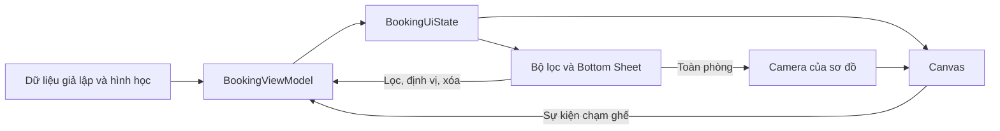

# Kiến trúc và thiết lập Android dự kiến

## Vị trí dự án đang dùng

Mở thư mục `CinemaMap/` trong Android Studio. Đây là gốc repo Git, chứa README, mã Android và thư mục tài liệu. Dự án template hiện dùng Wrapper 9.6.0, AGP 9.4.1, Gradle JDK 25 và API 37 làm compile/target. Canvas tổng quan đã nối với `MockCinemaData` và `MapGeometry`. Cấu trúc bên dưới mô tả đích triển khai bên trong `CinemaMap/` đối với các tệp Android.

## Thiết lập khi sinh viên yêu cầu

Nhóm bước dưới đây dùng để xác định việc cần làm. Khi sinh viên yêu cầu hướng dẫn setup, giải thích các lựa chọn và đưa từng thao tác để sinh viên thực hiện. Khi sinh viên giao Agent setup trực tiếp, thực hiện đúng phần được giao và dừng ở kết quả kiểm tra của phần đó.

1. Tạo dự án Android Studio loại Empty Views Activity, Kotlin DSL, một module `app`, package dự kiến `vn.edu.midterm.cinemamap`, Min SDK 26. Dùng AndroidX, ViewBinding, Lifecycle ViewModel/StateFlow, Material Components và RecyclerView cho danh sách trong Sheet.
2. Máy hiện có Android Studio, SDK platform 35/36 và ADB tại `~/Library/Android/sdk/platform-tools/adb`. JBR quan sát được là Java 25. Khi khởi tạo, xác minh ma trận tương thích AGP–Gradle–JDK–Kotlin, chọn bộ phiên bản ổn định, khóa bằng Wrapper và version catalog. Chọn JDK tương thích trong Android Studio nếu JBR mặc định lệch. Chốt `compileSdk`/`targetSdk` theo toolchain và kiểm tra system insets. Sự hiện diện SDK chưa chứng minh emulator hoặc Gradle chạy được.
3. Mở dự án trong Android Studio, đồng bộ Gradle, chọn emulator ARM64 hoặc thiết bị Android thật. Kiểm tra ADB nhận thiết bị, build, cài và khởi chạy ở cả hai hướng. Xác minh thêm bản clone sạch trước khi nộp.
4. Chạy lệnh Git từ gốc repo `CinemaMap/`. Theo dõi Gradle Wrapper gồm JAR, build scripts, mã nguồn, resources, test và tài liệu. Bỏ qua cấu hình SDK theo máy, build output, cache, thông tin ký và cấu hình IDE cá nhân. Lệnh kiểm tra từ thư mục `CinemaMap/` là `./gradlew :app:assembleDebug :app:testDebugUnitTest :app:lintDebug` và khi có thiết bị, `./gradlew :app:connectedDebugAndroidTest`.

## Cấu trúc mã dự kiến

```text
README.md
docs/
gradle/wrapper/
gradle/libs.versions.toml
app/src/main/
  AndroidManifest.xml
  java/vn/edu/midterm/cinemamap/
    data/MockCinemaData.kt
    model/Seat.kt
    model/CinemaLayout.kt
    map/MapGeometry.kt
    map/CameraTransform.kt
    map/SeatHitTester.kt
    map/CinemaMapView.kt
    ui/MainActivity.kt
    ui/BookingViewModel.kt
    ui/BookingUiState.kt
    ui/SelectedSeatAdapter.kt
  res/layout/
  res/values/
app/src/test/
app/src/androidTest/
```

`MockCinemaData` cung cấp suất, loại, giá và trạng thái gốc. `MapGeometry` lưu tọa độ và vùng hình học trong không gian sơ đồ. `CinemaMapView` vẽ và điều phối gesture, phát ID ghế khi hit. `BookingViewModel` xử lý sự kiện nghiệp vụ và công bố snapshot bất biến. `MainActivity` kết nối Canvas, thanh công cụ và Bottom Sheet, thu thập trạng thái theo lifecycle. UI dùng View và XML, thuật toán tọa độ và hit-testing dùng Kotlin có thể test JVM.



## Dữ liệu phòng

| Khu | Hàng | Cách bố trí | Đối tượng | Chỗ | Giá giả lập |
| --- | --- | --- | ---: | ---: | ---: |
| Thường | A–D | 9 ghế mỗi bên lối đi | 72 | 72 | 85.000 đ/ghế |
| VIP | E–J | 9 ghế mỗi bên lối đi | 108 | 108 | 110.000 đ/ghế |
| Đôi | K–L | 4 cặp mỗi bên, mỗi cặp là một khối rộng | 16 | 32 | 190.000 đ/cặp |
| Tổng | A–L | Hai khối, lối đi giữa | 196 | 212 | |

- Hàng thường/VIP có mã A01–J18 theo từng hàng. Ghế đôi dùng K01–K08 và L01–L08. Tất cả ID duy nhất, thứ tự theo hàng rồi số. Mỗi ghế có loại, mã khu, sức chứa, giá nguyên VND, trạng thái gốc và vùng chạm. Nhãn ghế đôi thể hiện 2 chỗ.
- Thông số world đề xuất cho ghế đơn rộng 36, cao 32, khoảng ngang 6, khoảng hàng 8, lối giữa 44, biên ngang tối thiểu 24. Tăng khoảng dọc 12 giữa các khu. Ghế đôi rộng 78, cao 32, khoảng ngang 6, căn giữa trong từng khối. Tính bounds từ toàn bộ hình vẽ gồm màn chiếu, nhãn và lề. Điều chỉnh sau bản vẽ thử với kiểm thử vùng chạm tương ứng.
- Fixture ổn định để tái hiện: đặt sẵn A03, A14, C09, E05, E06, F12, G13, H15, J02, K02 và L08. Không khả dụng B01, D18, F06 và L04. Còn lại 181 ghế trống. Dùng A05, E08, K03 để demo tổng 3 đối tượng, 4 chỗ, 385.000 đ. Khu Đôi + trạng thái Đang chọn ở phiên mới cho kết quả rỗng.

## Trạng thái và sự kiện

- Trạng thái gốc mỗi ghế là `Available`, `Booked` hoặc `Unavailable`. `selectedIds` là tập ID duy nhất có thứ tự chạm. Trạng thái Đang chọn được dẫn xuất khi ghế gốc Trống và ID nằm trong tập. Tạm tính là tổng giá từng đối tượng bằng số nguyên, số chỗ là tổng sức chứa.
- State gồm tập ID, ghế đang xem, điều kiện lọc gồm loại và trạng thái, nấc Sheet. Dẫn xuất danh sách, số kết quả và thông tin ghế. Loại và trạng thái được tổ hợp AND. Lọc trạng thái dùng trạng thái hiển thị sau chọn, có thể thay đổi kết quả ngay khi người dùng chọn/bỏ chọn.
- `TapSeat` trên ghế khớp lọc cập nhật ghế đang xem, bật/tắt chọn nếu ghế gốc Trống. Ghế Đã đặt/Không khả dụng cung cấp chi tiết. `RemoveSeat` cập nhật tập chọn và chi tiết hiện tại; sự kiện xóa lại cùng ID cho kết quả nhất quán. `LocateSeat` đưa camera tới ghế và vẽ vòng định vị tạm thời kể cả khi ghế đang làm mờ. Vị trí hiển thị vẫn tôn trọng giới hạn camera.
- `SetFilters`/`ClearFilters` giữ tập chọn, dùng cờ ngoài bộ lọc cho dòng liên quan. Ghế mờ không nhận thao tác từ Canvas. Nếu một ghế biến khỏi kết quả lọc ngay sau thao tác, Sheet ghi rõ điều kiện đang áp dụng, vẫn cho xóa mục đã chọn. Chi tiết dựa trên ID và trạng thái mới, kèm nhãn ngoài lọc khi cần.
- Camera vẽ được cập nhật cục bộ theo từng khung hình. Lưu `zoomRatio` và điểm world ở tâm viewport khi kết thúc gesture, khi ngắt vì đổi kích thước hoặc rời View. Giá trị fit mặc định có thể dùng cờ riêng. ViewModel giữ trạng thái qua xoay; `SavedStateHandle` lưu ID, khóa lọc, nấc sheet và thông số camera nhỏ gọn để hỗ trợ dựng lại. Dựng dữ liệu giả lập theo cùng ID, loại ID không hợp lệ khi phục hồi.
- Vùng camera là phần Canvas nhìn thấy phía trên Sheet, đã trừ toolbar, chú thích đúng vị trí và system insets. Khi Sheet đang chuyển động, cắt phần hiển thị và vùng nhận chạm tại mép Sheet. Ở nấc ổn định, tính lại viewport, giữ tâm world và tỷ lệ zoom tương đối nếu camera đã di chuyển, hoặc fit lại toàn phòng nếu đang ở góc mặc định. Khi một dòng yêu cầu định vị, dùng viewport hiệu lực sau nấc Sheet hiện hành.

## Camera, gesture và hit-testing

Gọi `p` là tọa độ pixel cục bộ của View, `w` là tọa độ world, `s` là hệ số dương và `t` là dịch chuyển. Bounds world có thể chuẩn hóa gốc về (0,0). Tính và dùng cùng một transform cho vẽ và kiểm tra chạm.

```text
p = s × w + t
w = (p − t) / s
fitScale = min(viewportWidth / worldWidth, viewportHeight / worldHeight)
s = fitScale × zoomRatio
zoomRatio ∈ [0.8, 5], mặc định 1
```

Với mỗi bước pinch, tính `anchor = (focusPrevious − tOld) / sOld` và `sNew = clamp(sOld × scaleFactor, 0.8 × fitScale, 5 × fitScale)`. Tính `tNew = focusCurrent − sNew × anchor` rồi clamp dịch chuyển. Cập nhật focus cũ mỗi bước và khởi tạo lại baseline khi số ngón thay đổi. Điểm dưới tâm hai ngón được giữ khi ràng buộc biên cho phép. Khi nội dung đã scale lớn hơn viewport trên một trục, với bounds world bắt đầu ở 0, giới hạn dịch trong `[viewportEnd − scaledExtent, viewportStart]`. Khi nhỏ hơn, căn giữa trục đó. Reset bằng hoạt ảnh nội suy camera đến fit, áp dụng giới hạn mỗi khung hình và hủy hoạt ảnh cũ khi có gesture mới. Thời lượng thử 220 ms và xác minh tùy chọn giảm chuyển động.

Pan dùng chênh lệch pixel của ngón đang điều khiển, bắt đầu sau touch slop. Tap chỉ được xác nhận khi chuỗi có một ngón, không vượt slop, không bị hủy và chưa từng vào pinch. Kết thúc pinch rồi thả hoặc chuyển lại một ngón không phát tap. Khi tiếp tục kéo một ngón sau pinch, đặt lại vị trí tham chiếu để tránh nhảy.

Trong vùng Canvas tương tác được, nghịch đảo tọa độ chạm sang world và kiểm tra ghế đang nhận thao tác. Dùng hình chữ nhật cùng kích thước dấu ghế vẽ, với quy ước `left ≤ x < right`, `top ≤ y < bottom`. Thiết kế dấu ghế hình chữ nhật, icon và viền lựa chọn nằm trong bounds. Giữ khoảng hở không thao tác giữa ghế, các lối đi và màn chiếu. Duyệt tuyến tính tối đa 250 bounds cho mỗi tap. Test round-trip và reproject điểm ở chính giữa/sát trong/sát ngoài biên qua các mức zoom và pan. Khi viewport chưa hợp lệ, đợi layout trước khi vẽ/nhận tương tác.

## Hiệu năng và nguồn kỹ thuật

Chuẩn bị một lần Paint, Path, bounds, chuỗi mã ghế và kiểu vẽ. Tính lại hình học khi cấu hình phòng đổi, cache palette theo theme. Khi vẽ, clip vùng Canvas khả kiến và dùng transform duy nhất. Cân nhắc bỏ qua ghế ngoài viewport khi trace cho thấy cần thiết. Theo ngưỡng zoom, giữ nhãn khu ở tổng quan và hiện mã ghế khi đủ chỗ. Vẽ lại theo camera, trạng thái hoặc thay đổi viewport. Sheet dùng danh sách tái sử dụng item và cập nhật theo ID. Đo trên thiết bị ghi rõ trước khi bổ sung tối ưu. [Android Developers — Vẽ với Custom View](https://developer.android.com/develop/ui/views/layout/custom-views/custom-drawing), [Tối ưu Custom View](https://developer.android.com/develop/ui/views/layout/custom-views/optimizing-view?hl=en).

Dùng SDK gesture cho dữ liệu scale và focus. Dùng ViewModel và saved state cho trạng thái giao diện nhẹ. Cấu hình Sheet thường trực và cân đối phần Canvas tương tác được theo chiều cao khả dụng. [Android Developers — Drag and scale](https://developer.android.com/develop/ui/views/touch-and-input/gestures/scale), [Save UI states cho Views](https://developer.android.com/topic/libraries/architecture/views/saving-states-views), [BottomSheetBehavior](https://developer.android.com/reference/com/google/android/material/bottomsheet/BottomSheetBehavior.html?hl=en).
