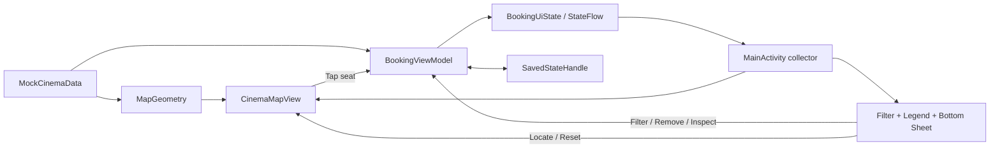

# Kiến trúc triển khai CinemaMap

Tài liệu mô tả mã hiện tại; các ý tưởng chưa triển khai được ghi riêng, không coi là chức năng đã có. Cách cài JDK/SDK/build nằm trong [README](../README.md#chạy-dự-án).

## Toolchain và module

Một module `app`, package `vn.edu.midterm.cinemamap`, Kotlin với AGP built-in Kotlin, Android Views/XML và Material Components. Không dùng Compose, ViewBinding hay engine 3D bên ngoài. Activity lấy View bằng `findViewById`. Gradle 9.6.0, AGP 9.4.1, JDK Gradle 25, Java source/target 11, compile/target SDK 37, min SDK 26. Các phiên bản thư viện xem `gradle/libs.versions.toml` và `app/build.gradle.kts`.

## Các lớp và trách nhiệm

| Lớp/tệp | Trách nhiệm |
| --- | --- |
| `model/Seat.kt` | Seat, SeatRow, SeatType(capacity/priceVnd), SeatAvailability |
| `data/MockCinemaData.kt` | Fixture 196 ghế, ID và trạng thái gốc cố định |
| `map/MapGeometry.kt` | Tính RowPosition/SeatPosition trong world; `findSeatAt` |
| `map/CameraTransform.kt` | Snapshot scale/offset, worldToView và viewToWorld |
| `map/CinemaMapView.kt` | Vẽ một Canvas, gesture, giới hạn camera, reset/minimap/định vị, SavedState camera |
| `ui/SeatFilter.kt` | AND loại/trạng thái; trạng thái đang chọn ưu tiên hơn trạng thái gốc |
| `ui/BookingUiState.kt` | Snapshot lựa chọn, lọc, ghế xem và các tổng dẫn xuất |
| `ui/BookingViewModel.kt` | Quy tắc chọn/xóa/lọc/xem; StateFlow; SavedStateHandle |
| `ui/SelectedSeatAdapter.kt` | Danh sách tái sử dụng trong Sheet, DiffUtil theo ID |
| `MainActivity.kt` | Nối listener/StateFlow với UI, Sheet, insets, Legend và kết quả 3D |
| `preview/` | Góc nhìn 3D và phát video, [chi tiết](07-preview-3d.md) |

Các tên `CinemaLayout`, `SeatHitTester` trong kế hoạch đầu chưa trở thành lớp riêng; chức năng tương ứng hiện ở `MapGeometry`. Cây mã thực nằm trong README và thư mục source.



## Dữ liệu và hình học

A–D: 72 ghế Thường; E–J: 108 VIP; K–L: 16 ghế Đôi. Tổng 196 đối tượng/212 chỗ. Có 11 Đã đặt, 4 Không khả dụng, 181 Trống lúc bắt đầu. Loại chứa sức chứa và giá nguyên VND, [bảng dữ liệu](../README.md#dữ-liệu).

World rộng 856, tâm X=428, cao 636; top hàng đầu 104. Ghế đơn 36×32, ghế đôi 78×32, khe ngang 6, khe hàng 8, thêm 18 giữa các khu, lối giữa 44. Mỗi hàng chia hai khối bằng nhau:

```text
seatsPerSide = row.seats.size / 2
blockWidth = seatsPerSide × seatWidth + (seatsPerSide − 1) × 6
leftBlock = 428 − 44/2 − blockWidth
rightBlock = 428 + 44/2
column = index % seatsPerSide
left = blockLeft + column × (seatWidth + 6)
```

`SeatRow` là dữ liệu một hàng. `SeatPosition` là **một ghế bất kỳ** kèm left/top/width đã tính; `RowPosition` gom các SeatPosition cùng hàng. Geometry được tạo một lần từ fixture; View không gửi vị trí ghế đầu để yêu cầu tính từng lần vẽ.

## Camera và hit-testing

```text
view = world × scale + offset
world = (view − offset) / scale
fitScale = min(viewWidth / worldWidth, viewHeight / worldHeight)
zoomRatio = scale / fitScale ∈ [0.8, 5]
```

`onDraw` save → translate → scale → vẽ world → restore → vẽ minimap theo pixel View. Dù gọi translate trước scale, kết quả trên điểm vẫn là nhân scale rồi cộng offset. `onSingleTapUp` nghịch đảo bằng chính camera hiện tại, gọi `findSeatAt`, kiểm tra matchingSeatIds rồi phát callback.

Hit-test dùng `left ≤ x < left+width` và `top ≤ y < top+32`, duyệt tuyến tính tối đa 196 ô. Ghế vẽ bo nhẹ, vùng chạm là hình chữ nhật; vòng định vị nằm ngoài bounds và không mở rộng hit-test. Màn chiếu, khe và lối giữa không phải ghế.

Pinch dùng điểm world ở focus trước, scaleFactor và focus mới. Sau khi clamp scale, tính `offsetNew = focusNew − anchor × scaleNew`. Clamp offset sau đó; gần biên không cam kết điểm neo cố định tuyệt đối. Pan dùng delta pixel trực tiếp. Với nội dung nhỏ hơn viewport, cho dịch ±15% viewport quanh tâm; nếu lớn hơn, giới hạn `[viewportSize − mapSize − margin, margin]`.

`hadMultiplePointers` ngăn tap sau chuỗi pinch. Khi nhấc còn một ngón, lưu pointerId và tọa độ tham chiếu để `ACTION_MOVE` tiếp tục pan. Quick scale một ngón tắt. Reset dùng ValueAnimator 220 ms về fit; hỗ trợ tắt animation hệ thống; chạm mới hủy reset cũ. `locateSeat` zoom ít nhất 2,5× fit rồi đưa ghế vào tâm trong biên cho phép và đánh dấu vòng tròn.

## State và đồng bộ hai chiều

`onSeatTapped` bỏ qua ghế lệch lọc; ghế Đã đặt/Không khả dụng chỉ đổi inspectedSeat. Ghế Trống bật/tắt trong danh sách, tính lại tổng theo loại. `inspectSeat` độc lập chọn vé. `removeSeat` bỏ theo ID và tính lại tổng. Lọc không xóa lựa chọn; Sheet đánh dấu ngoài bộ lọc và vẫn cho định vị/xóa. StateFlow được collect trong `repeatOnLifecycle(STARTED)`.

SavedStateHandle lưu ID chọn, ID xem, tên loại/trạng thái lọc. Khi tạo ViewModel mới: đọc ID, distinct, tra fixture, bỏ ID lạ/ghế không còn trống, tính lại tổng. Không tin tổng tiền đã lưu. Enum không hợp lệ trở về Tất cả. ViewModel mặc định do Activity `by viewModels()` tạo với saved-state factory; kiểm thử JVM truyền SavedStateHandle trực tiếp, không dùng no-arg constructor trong mã sản phẩm.

Camera lưu trong SavedState của `CinemaMapView` bằng Bundle chứa trạng thái cha, zoomRatio, tâm world, cờ fit. Chờ kích thước hợp lệ rồi áp snapshot; khi Sheet đổi kích thước tiếp, `onSizeChanged` giữ zoomRatio/tâm và clamp. Khi đang fit thì tiếp tục fit. Sheet do Material Behavior giữ nấc; Activity cập nhật nhãn sau layout và tại callback đổi nấc, tránh nhãn Xem ghế khi thực tế đã mở.

Đây là phục hồi UI của task, không phải cơ sở dữ liệu đặt vé. Unit test xác minh handle mới; instrumentation xác minh xoay/dựng lại Activity. Phạm vi thử hủy tiến trình thật được ghi trong tài liệu kiểm chứng, không suy diễn từ `recreate()`.

## Hiệu năng

Cache Paint, Path, RectF, geometry, palette và nhãn ngoài onDraw. Tái sử dụng bút; không tạo 196 View trên map. Vẽ lại khi camera/selectedIds/matchingIds/viewport thay đổi. Mã ghế luôn hiện ở 11,2 world, measureText để tự thu khi vượt đệm 8 world, baseline theo ascent/descent. Có thể cấp phát MapPoint nhỏ cho transform/minimap; đây không phải tạo tài nguyên đồ họa nặng mỗi ghế.

RecyclerView dùng ListAdapter và DiffUtil, itemAnimator tắt để tránh nháy lựa chọn. 3D giữ FloatBuffer/ma trận và chỉ dựng lại buffer ghế khi đổi ID; video dùng external texture và render theo frame. Không có tối ưu culling phức tạp khi chưa cần. [Kết quả và giới hạn đo](09-kiem-chung.md).

Tham khảo API: [Custom drawing](https://developer.android.com/develop/ui/views/layout/custom-views/custom-drawing), [gestures](https://developer.android.com/develop/ui/views/touch-and-input/gestures/scale), [UI state](https://developer.android.com/topic/libraries/architecture/views/saving-states-views), [BottomSheetBehavior](https://developer.android.com/reference/com/google/android/material/bottomsheet/BottomSheetBehavior).

## Tối ưu đường vẽ

Thông số cỡ chữ/baseline được tính một lần theo ID trong `seatLabels`, không gọi measureText/ascent/descent cho 196 ghế mỗi frame. `drawRoom` lấy bounds world của viewport và bỏ qua ô ghế ngoài vùng nhìn khi pan/zoom; ghế có vòng định vị vẫn được vẽ để giữ marker. Không cull dữ liệu hit-testing, vì vùng chạm phải dùng hình học đầy đủ. Màn chiếu, nhãn và ghế vẫn vẽ trực tiếp trên Canvas gốc, không tạo cache bitmap lớn hoặc View riêng từng ghế.

Đã thử cache Picture/RenderNode nhưng phép đo emulator không cho kết quả tốt hơn; bỏ hướng đó để giữ mã ngắn và đường vẽ dễ kiểm tra. Ca pixel thật sau chọn/xóa/lọc/zoom tiếp tục kiểm tra màu hiển thị. Kết quả gfxinfo và giới hạn đo nằm trong tài liệu 09.
